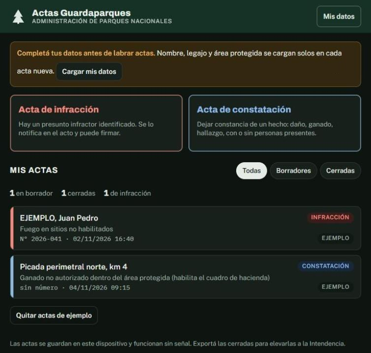
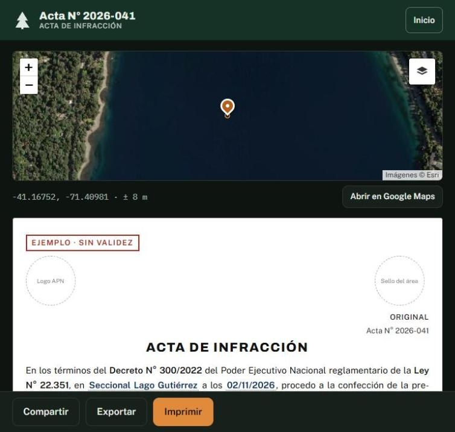
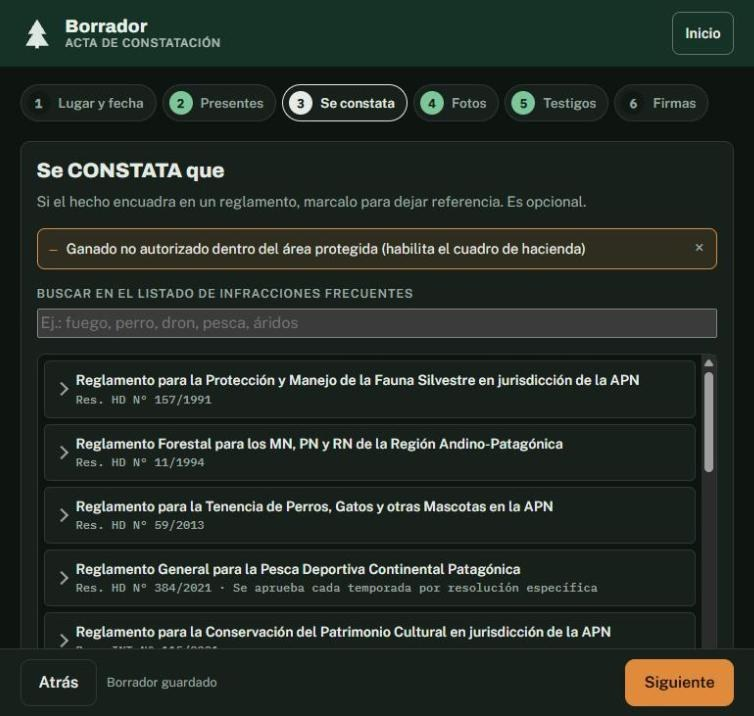
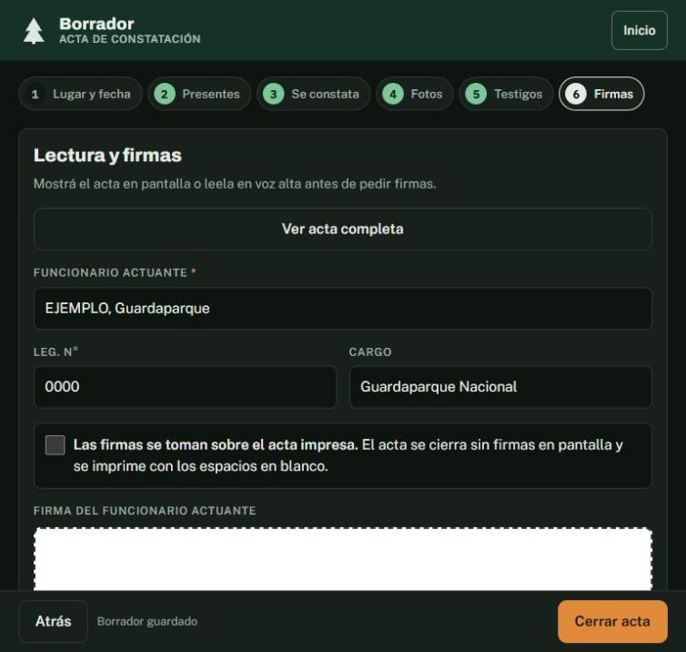
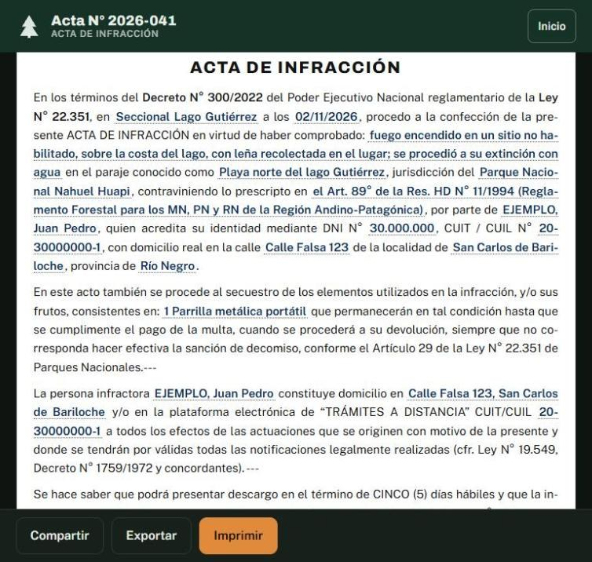

# Actas Guardaparques

### Infraction and inspection reports for Argentina's National Park Rangers, written on the phone and printed on the spot

**[Open the app →](https://rikochet87.github.io/actas-guardaparques/)** · installable · works with no signal

*An independent prototype built to replace the paper booklet. It is not an official app of the National Parks Administration (APN).*

<table>
<tr>
<td></td>
<td></td>
</tr>
<tr>
<td align="center">Home: two report types and the ranger's own reports</td>
<td align="center">A closed report, located on satellite imagery</td>
</tr>
</table>

---

## The problem

When a park ranger finds someone lighting a fire on a lakeshore or cattle grazing inside a protected area, the report is written by hand in a paper booklet: the official wording copied from memory, the regulation and article looked up later, no location, photos on a separate phone, and a copy that can be lost or altered. Most of this happens where there is no phone signal.

## What it does

A six-step guided form that produces the **official report text**, ready to sign and print, entirely offline.

| Step | What the ranger does |
|---|---|
| **1. Place and time** | Protected area, place name, and the GPS position taken automatically (or typed by hand) |
| **2. People present** | The alleged offender, or the people present, with ID and address |
| **3. Facts** | Searchable list of frequent infractions — fire, camping, pets, fishing, hunting, flora, drones, waste, vehicles, restricted areas, damage, commercial activity, livestock — each with base wording and the regulation and article it breaks |
| **4. Seizure and photos** | Seized items and photos from the camera |
| **5. Witnesses** | Names and IDs |
| **6. Signatures** | Touch-screen signatures for ranger, offender and witnesses, or a recorded refusal to sign |

<table>
<tr>
<td></td>
<td></td>
</tr>
<tr>
<td align="center">Step 3: the infraction catalogue by regulation</td>
<td align="center">Step 6: reading the report aloud and signing</td>
</tr>
</table>

**When the report is closed:**
- It gets a sequential number by report type and an **SHA-256 integrity code**, and it is locked: it can no longer be edited.
- The legally required notice is added automatically: five working days to file a defence before the park office or online (Decree 300/2022, art. 4).
- For unauthorised livestock, a cattle table following APN Resolution 467/2017.
- The printed report carries the coordinates and a **QR code** that opens the place on a map.

## Printing in the field

- **Portable 58/80 mm thermal printers over Bluetooth** (Chrome on Android, ESC/POS printers): original and copy, separated by a cut line.
- **Send to a printing app**: shares the ticket as an image, for iPhone or classic Bluetooth printers through the manufacturer's app.
- **A4 or letter** through the system dialog (Wi-Fi, USB or PDF).
- Option to take the signatures on the printed paper instead of the screen.

## How it was built

- **A single-page web app with no framework**: HTML, CSS and JavaScript in one page, a service worker for offline use and a manifest so it installs like an app.
- **Reports are stored on the device** (IndexedDB) and can be exported as JSON for the park office.
- **Leaflet** for the map and a small QR library, both bundled locally so nothing depends on a CDN in the field.
- The report wording follows the official APN templates for Infraction Reports (Decree 300/2022) and Inspection Reports.
- `fuente/` holds the source split by module; `fuente/build.py` assembles it into `index.html`.
- Built with AI agents (Claude Code) as the main development tool.

## Try it or host it

It is a static site: upload this folder to any host with **HTTPS** (GitHub Pages, Netlify, a park server). Open it once with signal on the phone and choose **"Add to home screen" / "Install app"**; from then on it works offline. Two example reports come preloaded and can be removed with one tap.

To run it on a computer: `python3 -m http.server 8000` in this folder and open http://localhost:8000

## What an official version would still need

- Confirming two regulation numbers in the infraction list (Fauna, HD Res. 157/1991, and Scientific Research, HD Res. ___/2016).
- Syncing with a park office server and centralised numbering per booklet.
- Integration with the national electronic records system (GDE).
- Legal validation of on-screen signatures.

---

**Matías Rosello** · [GitHub](https://github.com/rikochet87) · rosellomatias87@gmail.com

